# Urumaya (උරුමය) — Civic-Epistemic Infrastructure for Sri Lanka

> **"Urumaya is not an app. It is a sanctuary of understanding, a civic root system, and an offering for future Sri Lanka."**  
> — *Founder's Strategic Report: "Urumaya"*

---

## 🏛️ Executive Summary

**Urumaya** is a visionary civic-epistemic infrastructure initiative, aiming to empower Sri Lanka's citizens — particularly youth, educators, and community builders — with dignified, localized, and pressure-aligned knowledge systems.

It functions as an integrative public knowledge hub and modular civic API toolkit that bridges conceptual clarity, civic participation, and social healing. Rather than competing in saturated commercial software spaces, Urumaya establishes a foundational layer of open, ethical, and localized knowledge systems adaptable for diverse civic uses.

---

## 🔍 Background and Problem Landscape

Sri Lanka, like many post-colonial nations, suffers from an acute fracture between formal institutional systems and lived everyday reality. 
* **Youth** are culturally disoriented and overwhelmed by exam and economic pressure.
* **Teachers** are severely under-supported and burdened by administrative friction.
* **Communities** are epistemically disempowered, forced to navigate volatile inflation and governance changes without clear conceptual tools.

While fragmented educational dashboards, data portals, and civic advocacy campaigns exist, they fail to offer **integrative, pressure-informed clarity** that speaks directly to local realities. 

At the same time, global digital platforms have become increasingly extractive, algorithmic, performance-driven, and dislocated from emotional and cultural truth. There is an urgent need for an alternative knowledge layer that centers dignity, integration, and human flourishing.

---

## 🌟 Strategic Vision

Urumaya operates through four foundational pillars:

```
┌────────────────────────────────────────────────────────────────────────┐
│                        URUMAYA CIVIC CORE                              │
├──────────────────────────┬─────────────────────────────┬───────────────┤
│ 1. Living Knowledge Hub  │ 2. Open Civic API Toolkit   │ 3. Devneevma  │
├──────────────────────────┼─────────────────────────────┼───────────────┤
│ • Inflation & Economy    │ • Modular Civic Backend     │ • Pressure    │
│ • Exam & University Maps │ • Knowledge Graph Endpoints │   Navigation  │
│ • Burnout & Regulation   │ • Open Integration for NGOs │ • Convivial   │
│ • Sinhala / Tamil Access │ • Decentralized Verification│   Design (8px)│
└──────────────────────────┴─────────────────────────────┴───────────────┘
```

### 1. Living Civic Knowledge Hub
Accessible narratives, visual diagrams, and systems maps that explain real pressures:
* **Economic Reality**: Understanding inflation, debt cycles, and local supply chains.
* **Life Transitions**: Exam pressures (O/L, A/L), university pathways, vocational dignity, and youth burnout.
* **Civic Literacy**: Public policy mechanisms, administrative divisions (Provinces to Grama Niladhari), and emotional literacy.

### 2. Open Civic API Toolkit
A modular backend enabling teachers, civil society actors, independent developers, and grassroots organizations to plug into a shared knowledge core without building infrastructure from scratch.

### 3. Pressure-Aware Frameworks (Devneevma)
A unique theoretical contribution integrating emotional, conceptual, and systemic maps for pressure navigation — helping individuals maintain internal clarity and nervous system regulation while engaging with high-stress external systems.

### 4. Convivial Design Culture
Low-resource, human-first technology tailored to Sri Lanka:
* Works seamlessly in low-bandwidth, rural environments.
* Deeply multilingual across **Sinhala, Tamil, and English**.
* Clean, non-coercive user interfaces respecting human attention.

---

## 🎯 Target Use Cases

| Stakeholder | How Urumaya Serves Them |
| :--- | :--- |
| **Youth & Students** | Navigate life decisions, mental health, and societal pressures with dignity and systemic clarity. |
| **Teachers & Educators** | Access pressure-aware pedagogical tools to support divergent learners in high-pressure classrooms. |
| **Public Thinkers** | Share conceptually clear, emotionally grounded civic knowledge free of political capture. |
| **Ethical Developers** | Build localized educational and community applications using the open civic API toolkit. |
| **Civic Institutions** | Host dialogues, citizen assemblies, and field research informed by an open epistemic layer. |

---

## 🗺️ Implementation Roadmap

```mermaid
flowchart LR
    P1["Phase 1 (2025–2026)\nFoundation"] --> P2["Phase 2 (2026–2028)\nExpansion"] --> P3["Phase 3 (2028+)\nCommons Maturity"]
    
    subgraph P1["Phase 1: Foundation"]
        A1["Seed Research via EdLife"]
        A2["5-Domain MVP Knowledge Hub"]
        A3["Civic API Prototype"]
    end
    
    subgraph P2["Phase 2: Expansion"]
        B1["Trilingual Translation"]
        B2["School & NGO Pilots"]
        B3["Devneevma Toolkit Decks"]
    end
    
    subgraph P3["Phase 3: Maturity"]
        C1["National Educational Integration"]
        C2["Open Contributor Ecosystem"]
        C3["Civic Knowledge Cooperative"]
    end
```



---

## 🌐 Domain & Routing Architecture

* **Primary Studio Subdomain**: [`https://urumaya.intuituilabs.studio`](https://urumaya.intuituilabs.studio)
* **National Sri Lanka Gateway**: [`https://urumaya.lk`](https://urumaya.lk)
* **Institutional Lineage**: Conceived under Intuitui Labs in philosophical alignment with EdLove and EdLife.
